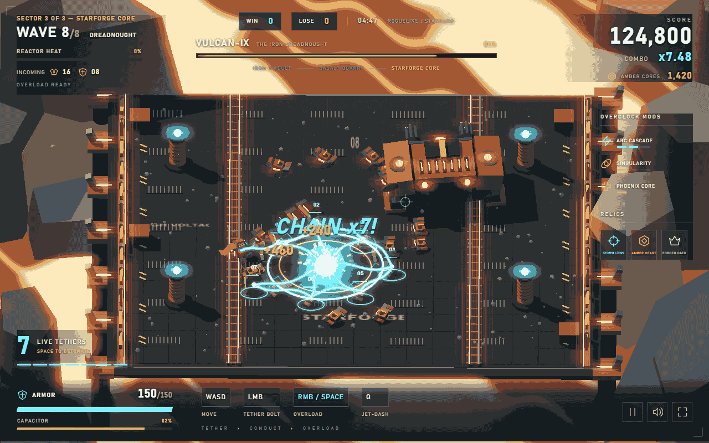

# STARFORGE RAILGUNNER: VOLT & AMBER

Thread a storm through an army. An original offline action roguelike by **@argaromit**, built for the [make.fun](https://make.fun) **Make the best game** bounty.



You are the last Starforge Ranger. Magnetic rail bolts anchor to hostile machines and conductor pillars, stitching up to eight targets into a live plasma circuit. Let the circuit grow, kite the swarm, then implode it. Three sectors, eight waves, two overclock drafts, and Vulcan-IX await.

## Play

The game has **no build step, no network dependencies, and no runtime installation**. Serve `game/` from any static HTTP server and open `index.html` in a desktop browser. With Node.js 22.18+:

```sh
node serve.ts
```

Open **http://127.0.0.1:5197**. The campaign starts with twelve drones; **Final Stand** is a separate, openly available wave-eight checkpoint with a preconfigured loadout and starting score. Campaign and checkpoint share the same mechanics and boss.

| Input | Action |
| --- | --- |
| WASD / arrows | Move |
| Hold left mouse | Fire magnetic tether bolts |
| Right mouse / Space | Overload all live tethers |
| Q | Jet dash, briefly invulnerable |
| 1 / 2 / 3 | Install an overclock in the workshop |
| Esc / P | Pause or resume |
| M | Toggle audio |
| F | Fullscreen |
| Enter | Start, restart, or resume |

Overload costs capacitor, which regenerates and refunds on kills. Tethers slow machines and arc automatically to nearby targets. Linked boss armor is vulnerable to overload. Reactor heat cools when firing stops and drops on detonation. Dash through the telegraphed boss sweep. Collect amber cores, preserve armor, and chain groups to raise the score multiplier.

## Original art and systems

- Authored articulated ranger, cloth scarf, rail rifle, three enemy roles, and a multi-barrel four-legged dreadnought.
- Layered basalt canyon, molten golden river shader, textured steel plate viaduct, conductor pylons, rail conduits, machinery, debris, and cast shadows.
- Custom offscreen bloom, animated branching lightning, dual overload shockwaves, implosion pulls, sparks, 40 ms hitstop, dash trails, and floating damage.
- Original synthesized soundtrack and event-driven Web Audio. Audio starts only after interaction. Pause, mute, and reduced-effect controls are included.
- Seeded randomness, fixed 120 Hz kinematic simulation, swept bolt collision, circle separation, shield pressure, boss telegraphs, draft upgrades, loss, retry, and persistent local records.

## Reproduce the dossier

`main.ts` uses only Node's standard library and the unchanged official `vendor/makefun-game.ts`:

```sh
# PowerShell
$env:MAKEFUN_OUTPUT_DIR = 'out'
node main.ts
```

It copies `game/` and the four `screenshots/` to the output and writes a deterministic `dossier.json`. The first screenshot by filename is the combat cover.

Development-only QA tools require `npm install` and `npx playwright install --no-shell chromium`. `npm test` exercises real browser input, an input-intent campaign bot, natural defeat, retry, offline references, UI bounds and text intersections, and WebGL diagnostics. `npm run capture` records four native browser screenshots and palette-compresses their PNGs. QA hooks exist only on localhost with `?qa=1`. The combat cover uses a posed Final Stand checkpoint; the workshop and victory screens are earned by running the campaign with gameplay input intents.

## Code map

| File | Responsibility |
| --- | --- |
| `game/combat.js` | Encounters, tether conduction, overload, enemies, boss, upgrades and run state |
| `game/world.js` | Viaduct, canyon, materials, lighting, camera and render pipeline |
| `game/models.js` | Ranger, enemies, dreadnought, batching and procedural animation |
| `game/vfx.js` | Plasma arcs, sparks, shockwaves, projectiles and capacitor pickups |
| `game/audio.js` | Original synthesized score and combat audio |
| `game/ui.js`, `game/ui.css` | HUD, title, workshop, pause and outcomes |
| `game/main.js` | Input, fixed-step loop, event wiring and local QA hooks |

MIT license. Three.js is vendored under its own MIT license. All game artwork, sounds, music, names and gameplay code were authored for this entry. No external game assets are used. See `artifacts/final-evidence.md` for checks and limitations.
